# VoxtNew

**English** · [简体中文](README.zh-CN.md)

**Speak anywhere on your Mac; the text lands where your cursor is.**

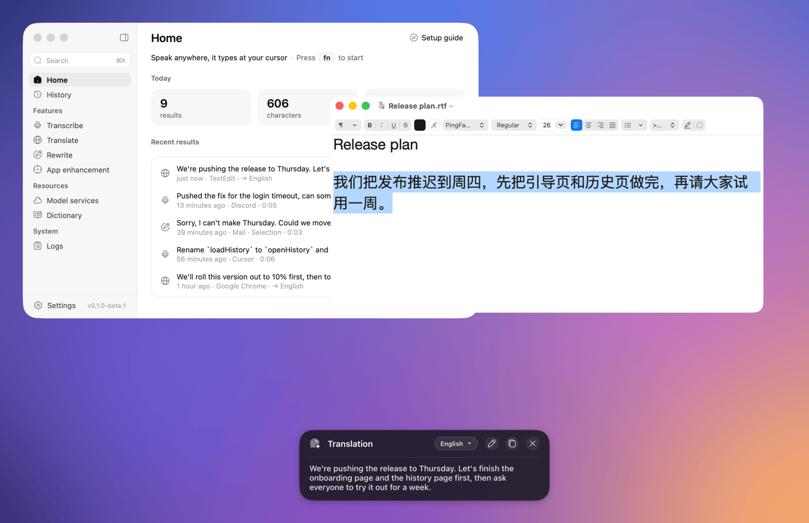

VoxtNew is a small voice input app for macOS. Press a shortcut in any app, speak, and the text is typed at the cursor: recognised by a speech service, cleaned up by a language model, adjusted to the app you are in. It also translates and rewrites, by voice or on the text you select.

It runs no models on your Mac. You choose the speech and language services (StepFun, Doubao, Alibaba Cloud, DeepSeek, OpenAI and others) and bring your own API keys; your audio and text go to them and nowhere else.

VoxtNew is a pared-down rewrite of [Voxt](https://github.com/hehehai/voxt), by the same author: Voxt's dictation, translation and rewriting, with remote models only, and without meetings, file transcription, notes or local models. Its interface and engineering come from [AudioSmith](https://github.com/hehehai/AudioSmith).

> **Status: 0.1.0-beta.1, the first beta (a GitHub prerelease).** Everything below is built and tested; the first signed builds come out on [Releases](https://github.com/sgl-project/sglang-omni/VoxtNew/releases) as betas. The app icon is still a placeholder.

<sub>Screenshots and recordings: VoxtNew 0.1.0-beta.1 on macOS 26, with sample data, StepFun for speech and DeepSeek for the language model.</sub>

## Features

### Transcribe, Translate, Rewrite

| Feature | Shortcut | What it does |
|---|---|---|
| **Transcribe** | `fn` | Speak, and the text is typed into the app in front. The language model removes fillers and false starts, fixes punctuation and numbers, and applies your rules; without a language model the text goes in as recognised. |
| **Translate** | `fn` `⇧` | Select text and press it to translate the selection; with nothing selected, translates what you say. Into the language you choose; the answer card switches to another language in place. |
| **Rewrite** | `fn` `⌃` | Select text and say how to change it ("shorter", "more formal"); with nothing selected, say what to write. The answer opens in a card where **Insert** puts it in place (over the selection) and **Continue** records a follow-up, kept as a conversation. |

Tap the shortcut to start, tap again to stop; `Esc` cancels. Each feature can have several shortcuts, each a tap, a double tap or a long press (hold to talk), set in **Settings → Shortcuts**, which also shows conflicts. `⌃⌘V` pastes the latest result again.

Results are pasted through the clipboard, which is put back afterwards. When there is nowhere to type (no text field in front, or the app changed), the result waits in the answer card instead, to copy or insert.

**Transcribe** in TextEdit: "Um, so let's move the design review to Thursday afternoon, uh, no wait, Friday morning…" comes out without the fillers and the false start ([MP4](docs/media/transcribe.mp4)).

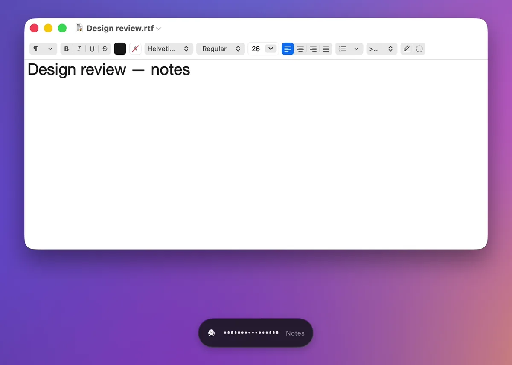

**Translate** the selection, then the card into Japanese ([MP4](docs/media/translate.mp4)).

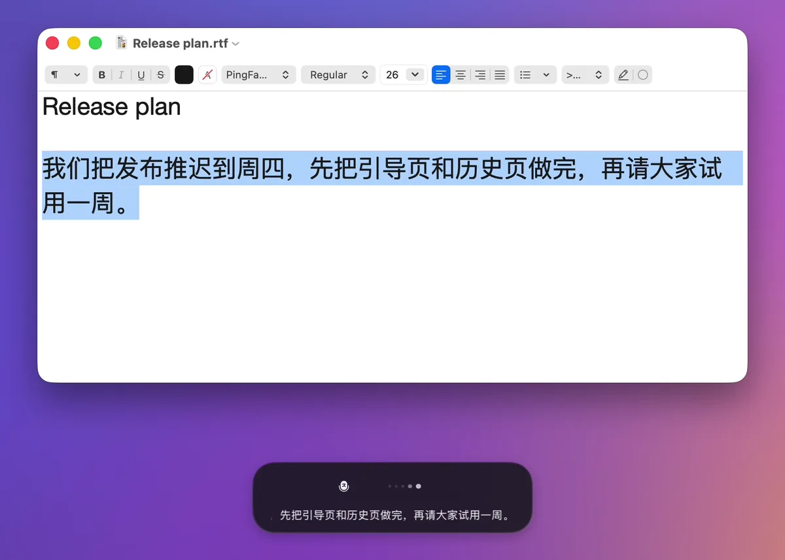

**Rewrite** a hasty note as an email, then a follow-up, then **Insert** over the selection ([MP4](docs/media/rewrite.mp4)).

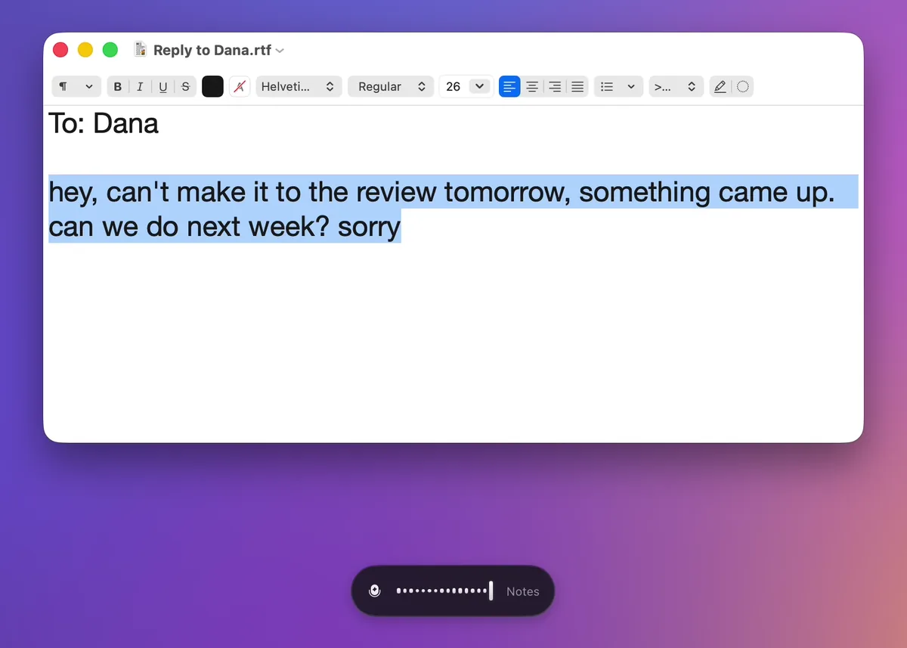

### App enhancement and the dictionary

- **App enhancement**: groups of rules by app and by website. Each group has a scene prompt layered on top of the clean-up ("a team chat: short and casual"), the features it applies to, and an optional key to press after inserting (Return in a messenger). Website rules match the browser tab's address, read through Accessibility. The page previews which group matches the app in front, and the overlay and the history show the group that applied.
- **Dictionary**: names and jargon, with aliases (what recognition tends to write instead). They are sent as hints to speech services that take them and as a glossary to the language model. Import and export as CSV or text.

| App enhancement | Dictionary |
|---|---|
| 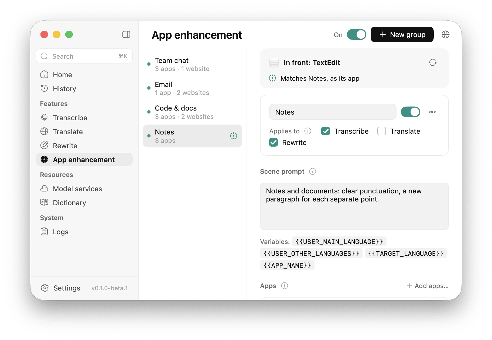 | 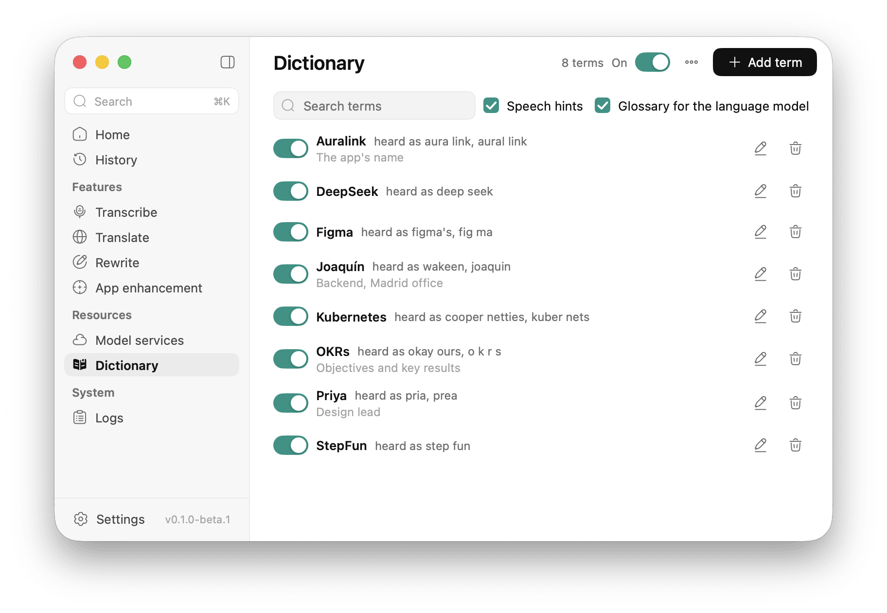 |

### The overlay

A small pill near the bottom of the screen shows the feature, a waveform and, with a streaming speech service, the words as you say them. It never takes the focus from the app you type into, has no buttons, and lets the pointer through. Results to read (a translation, a rewrite) come in an answer card with Insert, Copy, the target language and, for Rewrite, Continue. Position, opacity and corners are in **Settings → Overlay style**.

| Recording, with the app enhancement group | The words recognised, while the model tidies them |
|---|---|
| 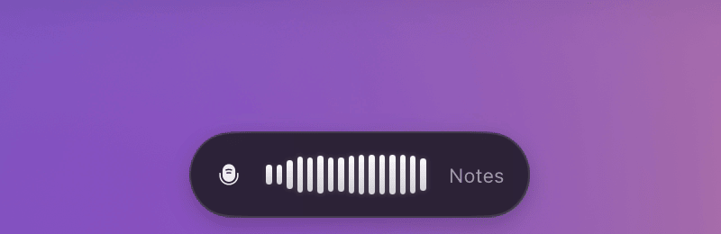 | 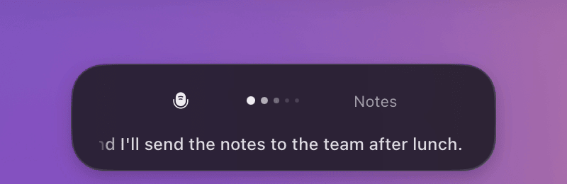 |
| **Translation, and the card's language menu** | **Rewrite, with a follow-up** |
| 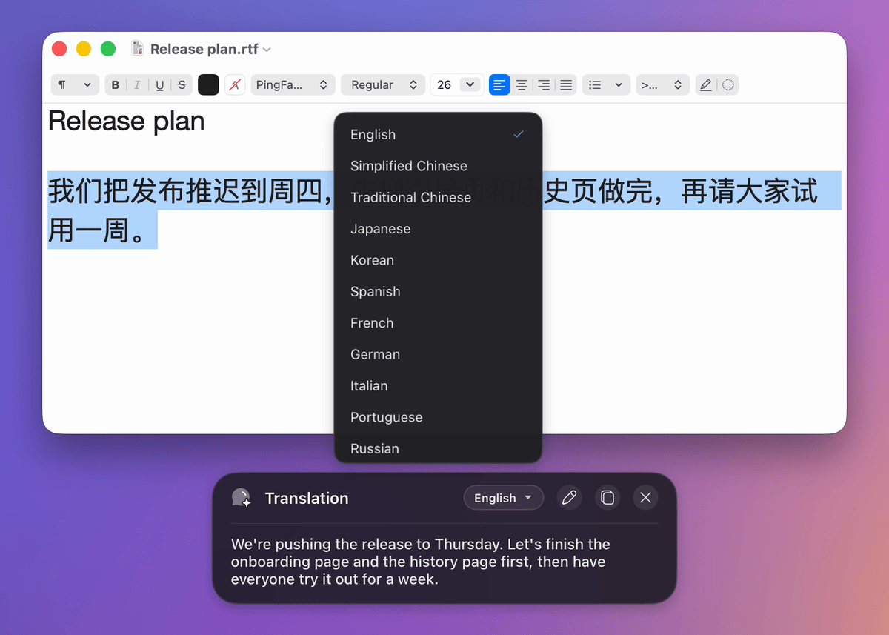 | 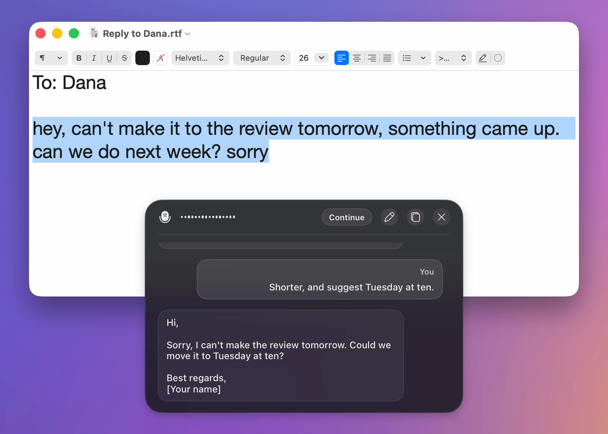 |

### Sound and silence

Before audio goes to a speech service, VoxtNew can prepare it (plain signal processing, no model):

- **Optimize sound** (on by default): a high-pass filter at 80 Hz removes hum and rumble, and one gain measured on the speech alone raises a quiet voice (up to +12 dB, without lifting background noise above −50 dBFS), with a limiter so nothing clips.
- **Skip silence** (on by default): leading and trailing silence is cut and long pauses shortened before upload, which saves upload time and, with services billed by duration, money. A recording with no speech is not sent at all.

The recording kept in the history is always the original. Both switches are in **Settings → Audio**, with the microphones in your order of preference.

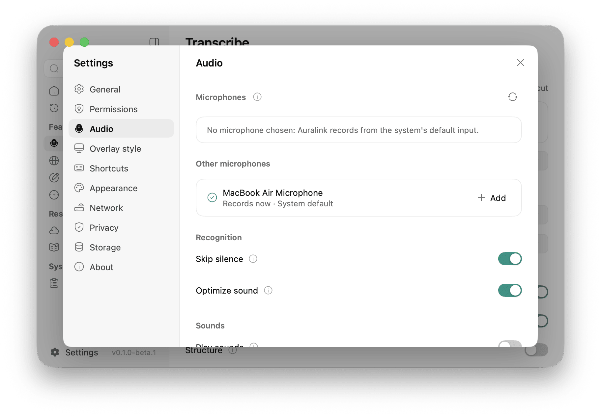

### History, menu bar and the rest

- **History**: every result by feature, searchable, with the source text, where it went, the services, the app enhancement group and each stage's time. Recordings are kept only if you turn that on.
- **Menu bar**: start or stop transcribing, paste the latest result, copy one of the last three. Closing the window keeps VoxtNew running there; it can open at login.
- **Setup guide** on the first start: permissions, services, then a real try of each feature.
- Command palette (`⌘K`), settings (`⌘,`), a light and a dark theme, English and Simplified Chinese.

| Home | History | Menu bar |
|---|---|---|
| 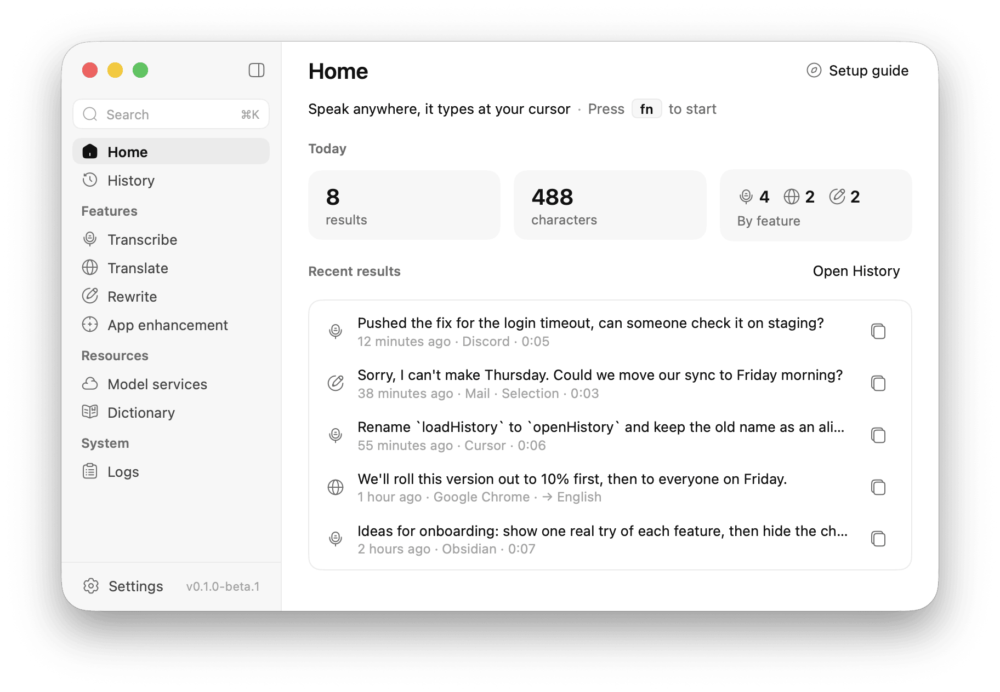 | 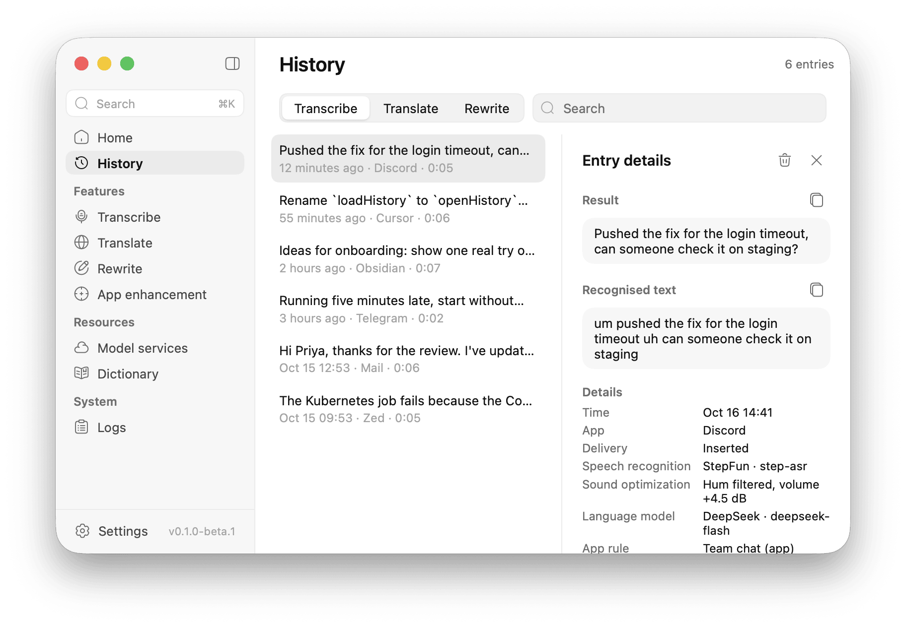 | 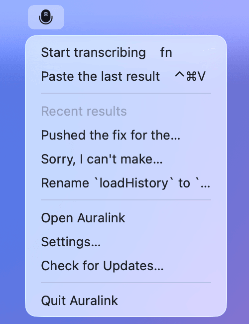 |

### Updates

Signed releases update themselves from GitHub Releases: a daily check, the new version's notes in a window of their own, a download of only what changed, and installation when you say so (or automatically, if you turn that on). **Check for Updates…** is in the app menu, the menu bar icon's menu and **Settings → About → Updates**. Updates keep the Microphone and Accessibility grants.

**Beta updates**: a switch in **Settings → About → Updates** that chooses whether to get betas. It is on by default while you run a beta and off in a release. On, you get whichever is newer, beta or release; off, releases only, and VoxtNew never goes back: a beta stays until a newer release.

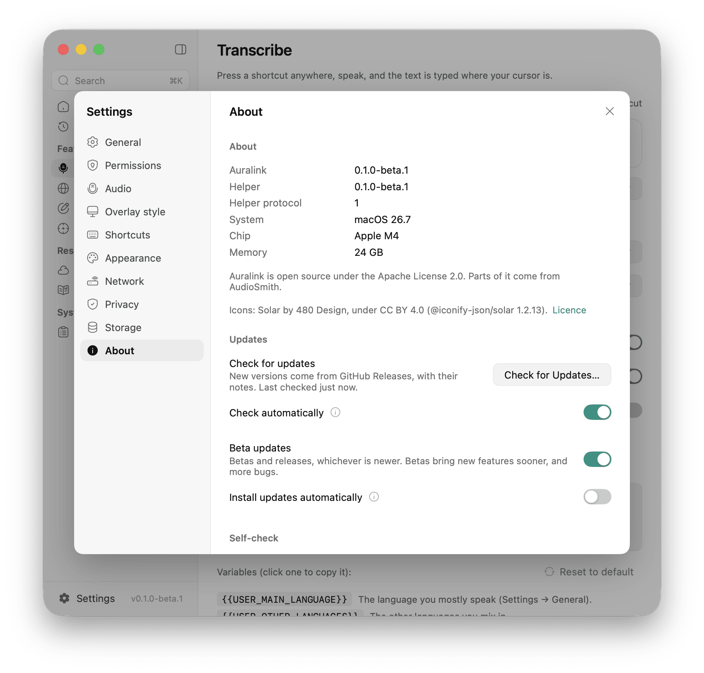

## Services

At least one speech service is required. A language model is needed for the clean-up, Translate and Rewrite.

**Speech recognition**

| Service | How | Models offered |
|---|---|---|
| Doubao (Volcengine) | streaming, live text | streaming ASR 2.0 and 1.0 |
| Alibaba Cloud Model Studio | streaming, live text | Fun-ASR, Paraformer, Qwen3-ASR realtime, Qwen-Audio ASR |
| StepFun | upload after recording | step-asr, step-asr-1.1 |
| OpenAI-compatible | upload after recording | gpt-4o-mini-transcribe, gpt-4o-transcribe, whisper-1, or any model on any compatible endpoint (Groq, SiliconFlow, a server of your own…) |

**Language models**: DeepSeek, Qwen (Alibaba Cloud Model Studio, China and international), Volcengine Ark (Doubao), Moonshot Kimi (China and international), Zhipu GLM, MiniMax, StepFun, Xiaomi MiMo, SiliconFlow (China and international), OpenAI, Anthropic, Google Gemini, OpenRouter, Groq, xAI, Mistral, Together AI, Fireworks AI, Cerebras, NVIDIA NIM, and any OpenAI-compatible endpoint.

Every preset has a default model and lets you type another. **Model services** shows which service each feature uses (the first ready one, or one you pick) and tests each connection. API keys are stored in the macOS Keychain, never in the settings, history or logs.

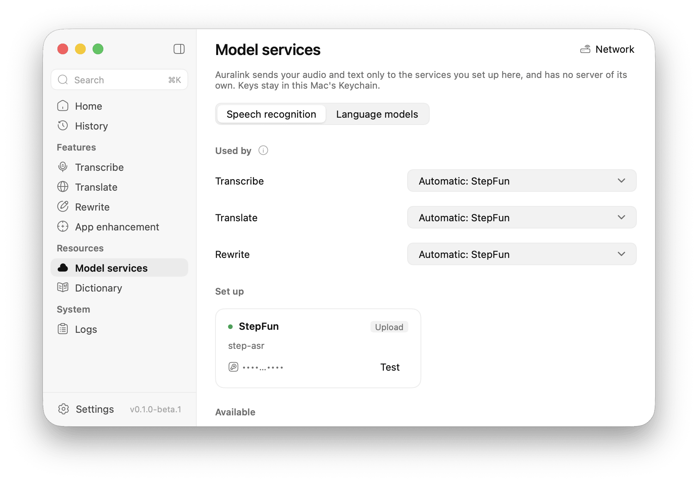

## Privacy

- **No local inference, no server of our own.** Your audio and the text to clean up, translate or rewrite go only to the services you set up; each service's own terms apply to what it receives. VoxtNew has no account and collects no usage data, crash reports or identifiers.
- **Keys** stay in this Mac's Keychain.
- **History** stays on this Mac, in `~/Library/Application Support/VoxtNew` (movable in **Settings → Storage**). **Settings → Privacy** turns the history off, turns keeping recordings on (off by default) and clears the history. Logs hold lengths and timings, not your text, unless you allow it.
- **Browser addresses** are read through Accessibility only to choose an app enhancement group. They are never sent to a model; only the app's name is.
- Besides your services, VoxtNew contacts GitHub to check for updates, and the hosts you test yourself in Settings (Network, the self-check).

## Install

VoxtNew needs **macOS 15 or later on Apple silicon**. Intel Macs are not supported yet.

1. Download `VoxtNew <version> arm64.dmg` from [Releases](https://github.com/sgl-project/sglang-omni/VoxtNew/releases) and drag VoxtNew to Applications. Releases are signed with a Developer ID and notarised by Apple, so they open without warnings.
2. Open it from Applications (an app run from the disk image cannot update itself). To update itself it must be able to write where it is: in `/Applications` that takes an administrator account; otherwise use `~/Applications`.
3. The setup guide asks for two permissions:
   - **Microphone**: to record while a shortcut is active, and only then.
   - **Accessibility**: to type the result into other apps, read the selected text for Translate and Rewrite, use `fn` as a shortcut, and read the app and browser tab in front for app enhancement. Without it, results are copied instead of typed.

**Coming from a build you made yourself** (ad hoc signed): macOS does not carry its grants over. Once, before opening the release: `tccutil reset Microphone dev.hehehai.voxtnew && tccutil reset Accessibility dev.hehehai.voxtnew`, then allow both again.

## Getting started

1. In the setup guide (or later in **Model services**), add a speech service and a language model with their keys and test them. For example StepFun for speech and DeepSeek for the language model.
2. Click into any text field, tap `fn`, speak, tap `fn` again. The text appears at the cursor.
3. Select a sentence and tap `fn` `⇧` to translate it, or `fn` `⌃` and say how to rewrite it.
4. In **App enhancement**, make a group for your chat apps or a website with a scene prompt; in **Dictionary**, add the names recognition gets wrong.

The setup guide opens again from Home (**Setup guide**) or **Settings → General**.

## Build from source

Needs Go 1.27.1 (`GOTOOLCHAIN=auto` fetches it) and, to package, a Mac with macOS 15 or later on Apple silicon and Xcode for the Swift helper.

```sh
scripts/build-helper.sh              # the Swift helper, into resources/darwin-arm64/helper/
go tool mygo dev                     # run with hot reload
go tool mygo build                   # build/darwin-arm64/VoxtNew.app and "VoxtNew 0.1.0 arm64.dmg"
```

From Linux, `scripts/mac.sh <command>` mirrors the project to a Mac (`MAC_HOST`, default `mac-air`; `MAC_DIR`, default `code/VoxtNew`) and runs the command there: `scripts/mac.sh 'scripts/build-helper.sh && go tool mygo build'`.

<details>
<summary>Signing during development (keeping the permissions across rebuilds)</summary>

macOS keeps the Microphone and Accessibility grants for a signature. An ad hoc signed build (the default) has a new one each time the app is rebuilt, so after a rebuild macOS forgets them: the microphone turns **denied without asking again**, and Accessibility still shows on in System Settings but does not work. The helper's grants are the app's (macOS checks the helper against VoxtNew.app, its responsible process), so the same happens to it. Ways around it:

- **Change only the helper:** keep one built app and run it with a helper outside the bundle. The helper inherits the app's grants wherever it lives, so rebuilding it costs nothing:
  ```sh
  scripts/build-helper.sh --out ~/voxtnew-dev
  open --env VOXTNEW_HELPER=$HOME/voxtnew-dev/voxtnew-helper build/darwin-arm64/VoxtNew.app
  ```
- **Start over:** `tccutil reset Microphone dev.hehehai.voxtnew` (likewise `Accessibility`), then open the app and grant again. If a stale Accessibility entry stays on but does nothing, remove it with − in System Settings and grant again.
- **Sign with a fixed identity:** an Apple Development certificate keeps the grants across rebuilds: `go tool mygo build -sign "Apple Development: …"` (or `macos.signingIdentity` in a local mygo.json; `VOXTNEW_SIGN_IDENTITY` for `scripts/build-helper.sh`). Over ssh, `codesign` fails with `errSecInternalComponent` until the key may be used without the GUI: once, in Terminal on the Mac, `security set-key-partition-list -S apple-tool:,apple: -s ~/Library/Keychains/login.keychain-db`.

</details>

## Development

VoxtNew is a Go app on [MyGo](https://github.com/egoist/mygo) (native macOS UI from Go, no cgo) and a small Swift helper for what needs Apple's frameworks: the microphone, global shortcuts, Accessibility, pasting and app icons. Go decides; the helper does what it is told over JSON lines on stdin and stdout. Everything but the helper is plain Go and is tested on Linux.

```sh
CGO_ENABLED=0 go test ./...          # everything; runs on Linux
go tool mygo vet .                   # go vet and MyGo's UI-lifetime checks
VOXTNEW_SNAPSHOTS=/tmp/shots go test -run TestSnapshots .   # every page as PNG, light/dark, en/zh-Hans
cd helper && swift test              # the Swift helper (on a Mac), against the same protocol fixtures
```

The store's tests use MyGo's SQLite plugin, which downloads its library once (checked against its SHA-256) or uses `MYGO_SQLITE_LIBRARY`. On Linux the overlay's pixel checks of Chinese text need a CJK font (Ubuntu: `fonts-noto-cjk`). This README's screenshots and recordings come from a demo build on a Mac: [scripts/readme-media](scripts/readme-media/README.md).

CI runs gofmt, the Go tests (also under the race detector) and MyGo vet on Linux, and the helper's tests on macOS. What needs permissions, a screen and real services is checked by hand with [docs/manual-test.md](docs/manual-test.md) (in Chinese). Releases are built, signed, notarised and published by GitHub Actions from a tag: [docs/release.md](docs/release.md).

- [docs/architecture.md](docs/architecture.md): packages, threading, the session, the prompt composer, data on disk.
- [docs/behavior.md](docs/behavior.md): what VoxtNew does differently from Voxt, and why.
- [docs/helper-protocol.md](docs/helper-protocol.md): the helper's protocol.
- [AGENTS.md](AGENTS.md): the rules for changes (strings, threading, the helper protocol).
- [CHANGELOG.md](CHANGELOG.md): changes by version.
- [CONTRIBUTING.md](CONTRIBUTING.md): how to send a change, and the CLA.

## Acknowledgements

- [Voxt](https://github.com/hehehai/voxt): VoxtNew rewrites its behaviour feature by feature, with remote models only. The overlay's icons, the menu bar microphone and the overlay preview's background are Voxt's.
- [AudioSmith](https://github.com/hehehai/AudioSmith): the window shell, the UI kit, the settings, the store and the supervisor VoxtNew's helper grew from.
- [MyGo](https://github.com/egoist/mygo): native macOS UI from Go, without cgo (MIT).
- [Solar](https://www.figma.com/community/file/1166831539721848736) icons by 480 Design, under CC BY 4.0.

## Contributing

Issues and pull requests are welcome: [CONTRIBUTING.md](CONTRIBUTING.md) says how, and how to sign the [Contributor License Agreement](CLA.md) (one comment on your first pull request).

## Licence

Copyright (C) 2026 actnow and the VoxtNew contributors. VoxtNew is free software under the [GNU Affero General Public License, version 3 or later](LICENSE) (AGPL-3.0-or-later).

In short: you may use, study, change and share VoxtNew. If you distribute it, changed or not, you pass on the same freedoms: the source, under the same licence. The AGPL adds one condition to the GPL: if you change VoxtNew and let people use your changed version over a network, you offer them its source too. VoxtNew is a desktop app, so using it on your Mac, as it is, asks nothing of you.

Contributions come in under the [CLA](CLA.md): contributors keep their copyright and give actnow the right to license their work under other terms as well. Versions up to v0.1.0-beta.1 were released under the Apache License 2.0. Third-party material and its licences are listed in [NOTICE](NOTICE).
