# Auralink

[English](README.md) · **简体中文**

**在 Mac 上任何地方说话，文字落在光标处。**

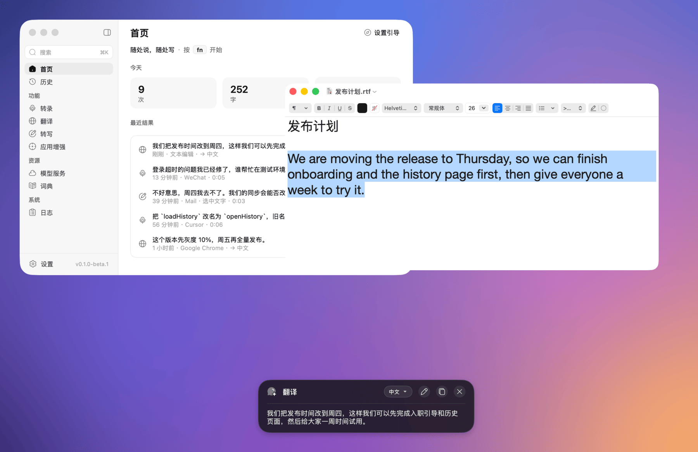

Auralink 是一个精简的 macOS 语音输入 app。在任意 App 里按下快捷键说话，文字就输入到光标处：语音识别服务转成文字，语言模型整理，并按你所在的 App 调整。它还能翻译和改写，对象可以是你说的话，也可以是选中的文字。

它不在 Mac 上跑任何模型。语音和语言服务由你来选（阶跃星辰、豆包、阿里云、DeepSeek、OpenAI 等），使用你自己的 API Key；音频和文字只发给这些服务。

Auralink 是同一作者的 [Voxt](https://github.com/hehehai/voxt) 的精简重写：保留 Voxt 的听写、翻译和改写，只用远程模型，去掉了会议、文件转录、笔记和本地模型。界面和工程沿用 [AudioSmith](https://github.com/hehehai/AudioSmith)。

> **状态：0.1.0-beta.1，第一个 beta 版（GitHub 上的 prerelease）。** 下面的功能都已完成并通过测试；第一批签名版本会先以 beta 形式发布在 [Releases](https://github.com/hehehai/Auralink/releases)。app 图标目前还是占位的。

<sub>截图和录屏：Auralink 0.1.0-beta.1，macOS 26，演示数据；语音识别用阶跃星辰，语言模型用 DeepSeek。</sub>

## 功能

### 转录、翻译、转写

| 功能 | 快捷键 | 做什么 |
|---|---|---|
| **转录** | `fn` | 说话，文字输入到当前 App。语言模型会去掉口头禅和说错重来的部分，修正标点和数字写法，并应用你自己的规则；没有配置语言模型时，直接输入识别出的原文。 |
| **翻译** | `fn` `⇧` | 选中文字后按下，翻译选中的内容；没有选中文字时，翻译你说的话。目标语言由你选，在答案卡片里可以直接换成另一种语言。 |
| **转写** | `fn` `⌃` | 选中文字后说出怎么改（“精简一点”“改正式一些”）；没有选中文字时，说出要写什么。结果显示在卡片里：**插入**会把它放到原处（替换选中的文字），**继续**可以再录一段追问，前后内容以对话形式保留。 |

轻按快捷键开始，再按一次结束；`Esc` 取消。每个功能可以设置多个快捷键，每个都可以是轻按、双击或长按（按住说话），在 **设置 → 快捷键** 中修改，冲突会直接提示。`⌃⌘V` 再次粘贴最近一次的结果。

结果通过剪贴板粘贴，粘贴后会恢复原来的剪贴板内容。如果没有地方可以输入（前台没有输入框，或者已经切到别的 App），结果会留在答案卡片里，可以复制或插入。

在文本编辑里**转录**：“嗯，那个设计评审改到周四下午吧，呃，不对，周五上午……”，输入的是去掉口头禅和改口之后的文字（[MP4](docs/media/zh/transcribe.mp4)）。

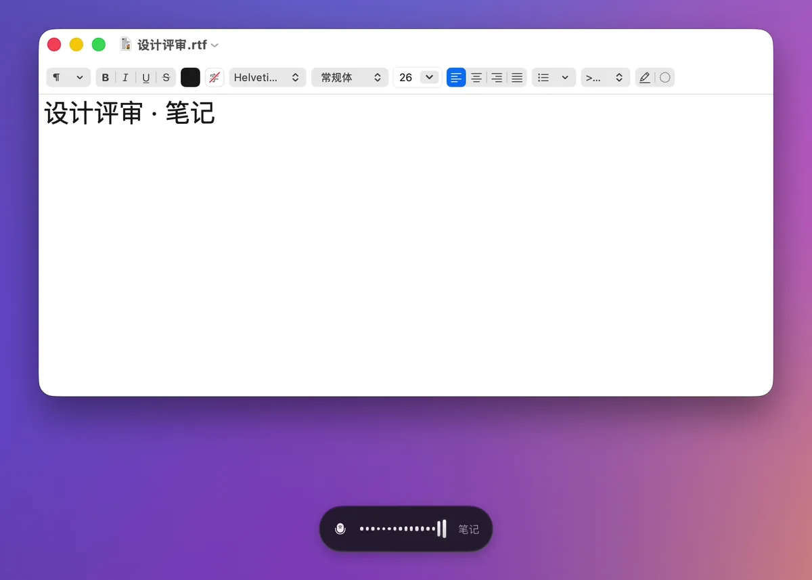

**翻译**选中的文字，再在卡片里换成日语（[MP4](docs/media/zh/translate.mp4)）。

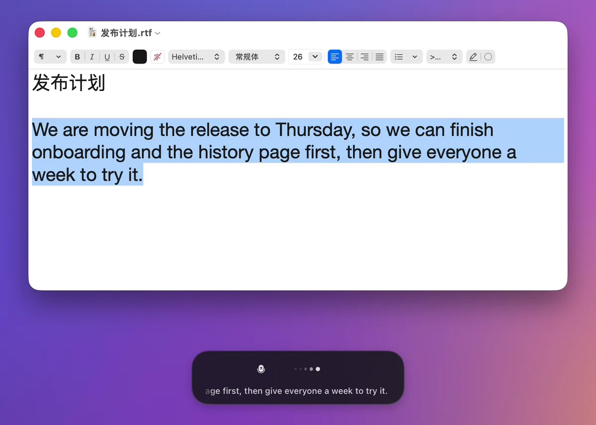

把随手写的一句话**转写**成邮件，再追问一次，最后**插入**替换选中的文字（[MP4](docs/media/zh/rewrite.mp4)）。

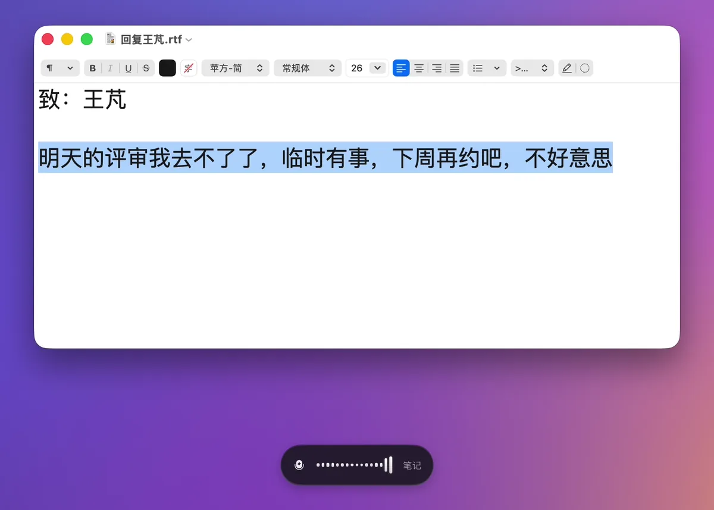

### 应用增强和词典

- **应用增强**：按 App 和网站分组设置规则。每个分组有一段场景 prompt，叠加在基础整理之上（比如“团队聊天：简短、口语化”），可以指定适用于哪些功能，以及插入后要不要按一个键（比如在聊天软件里按回车）。网站规则匹配浏览器当前标签页的网址，网址通过辅助功能读取。页面上会实时显示当前前台 App 命中哪个分组，浮窗和历史里也会标出用到的分组。
- **词典**：人名和术语，可以设置别名（识别时常被写成的样子）。词条会作为提示发给支持的语音识别服务，并作为术语表发给语言模型。支持 CSV 和文本格式的导入导出。

| 应用增强 | 词典 |
|---|---|
| 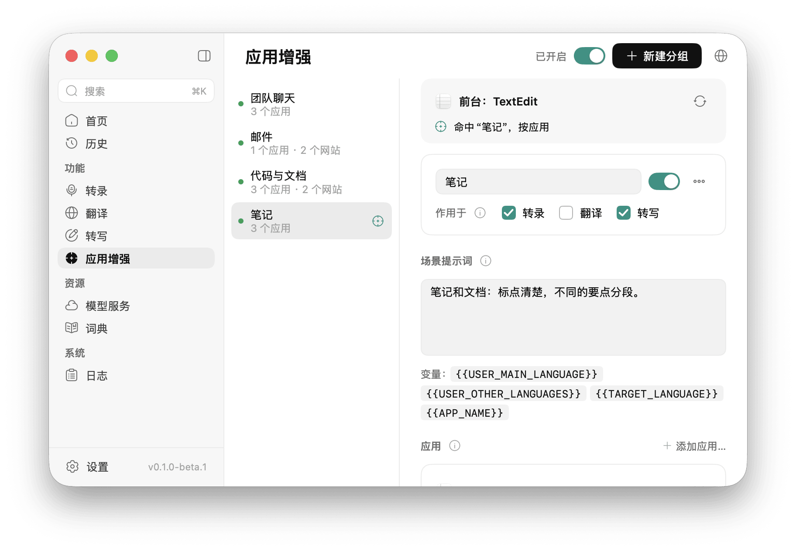 | 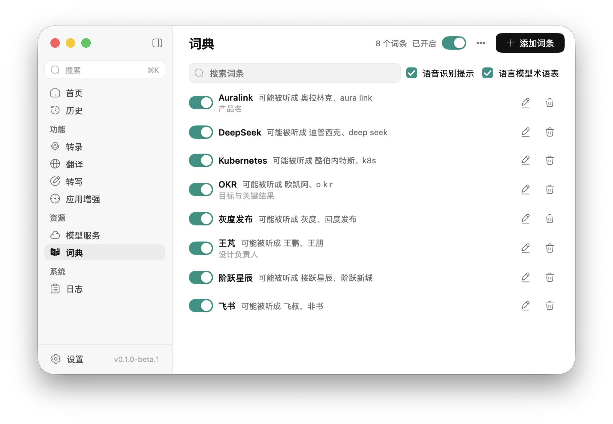 |

### 浮窗

屏幕底部附近的小胶囊显示当前功能和声波；使用流式语音识别服务时，还会随着你说话实时显示文字。它不会抢走你正在输入的 App 的焦点，没有按钮，鼠标可以直接穿过。需要阅读的结果（翻译、转写）显示在答案卡片里，带插入、复制、目标语言，转写还有继续追问。位置、不透明度和圆角在 **设置 → 浮窗样式** 中调整。

| 录音中，显示命中的应用增强分组 | 识别出的文字，语言模型正在整理 |
|---|---|
| 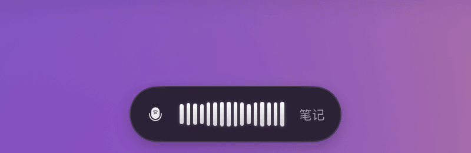 | 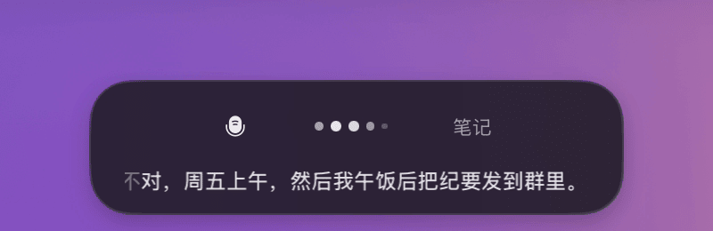 |
| **翻译，以及卡片的语言菜单** | **转写，带一次追问** |
| 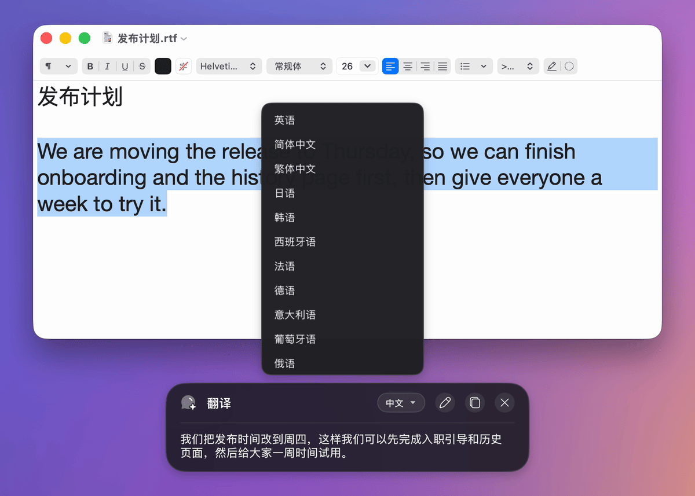 | 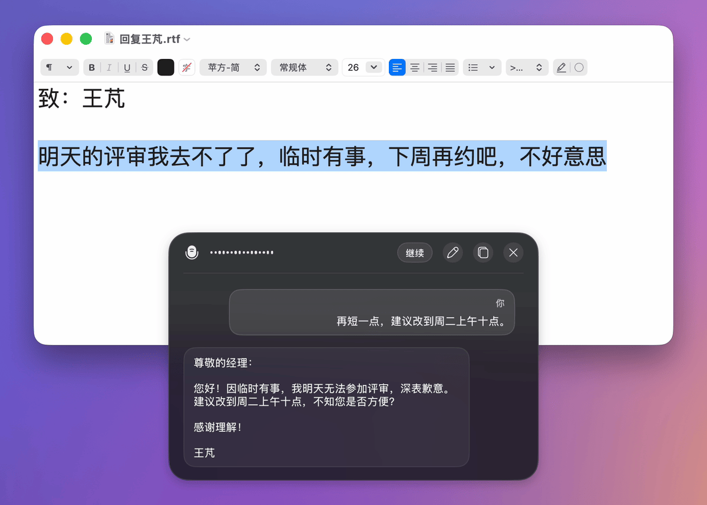 |

### 声音和静音

音频发给语音识别服务之前，Auralink 可以先做处理（纯信号处理，不用模型）：

- **声音优化**（默认开启）：80 Hz 高通滤波去掉嗡声和低频隆隆声；只按人声部分测量音量并统一调整增益，把小声的说话抬上来（最多 +12 dB，背景噪声不会被抬到 −50 dBFS 以上），再加一个限制器，避免削波。
- **跳过静音**（默认开启）：上传前裁掉开头和结尾的静音，缩短长停顿，减少上传时间；对按时长计费的服务也能省钱。完全没有说话的录音不会发送。

历史里保存的录音始终是原始录音。这两个开关都在 **设置 → 音频**，同一页还可以按优先顺序排列麦克风。

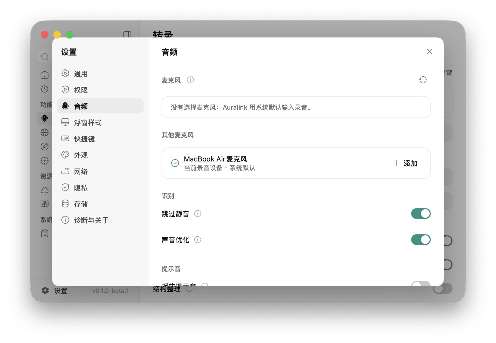

### 历史、菜单栏及其他

- **历史**：所有结果按功能分类，可搜索，记录原文、结果去了哪里、用了哪些服务、命中的应用增强分组和每个阶段的耗时。只有打开相应设置时才保存录音。
- **菜单栏**：开始或停止转录、粘贴最近的结果、复制最近三条结果之一。关闭窗口后 Auralink 留在菜单栏里继续运行，也可以设置开机启动。
- **设置引导**：首次启动时打开，依次完成授权、配置服务，再把每个功能实际试一遍。
- 命令面板（`⌘K`）、设置（`⌘,`）、浅色和深色主题，界面有英文和简体中文。

| 首页 | 历史 | 菜单栏 |
|---|---|---|
| 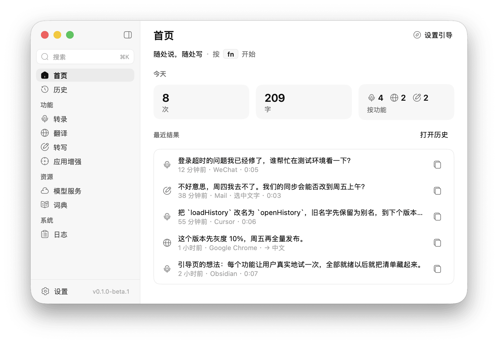 | 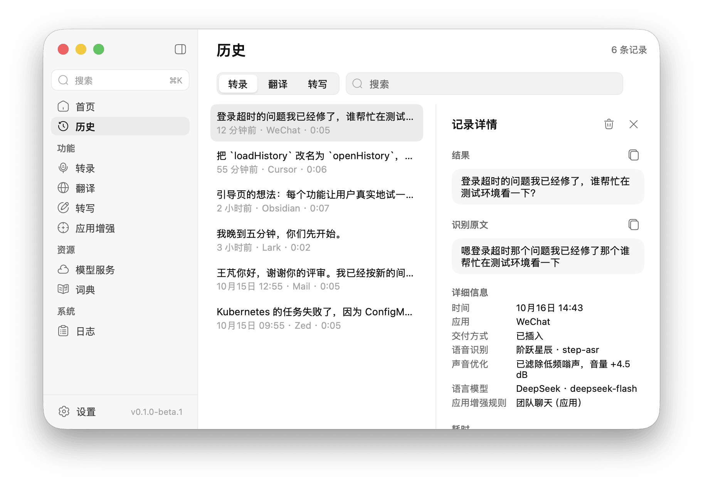 | 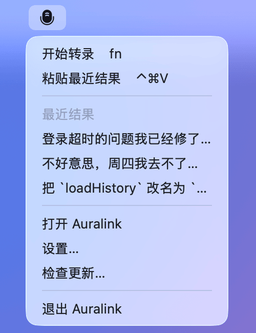 |

### 更新

签名的发布版会从 GitHub Releases 自动更新：每天检查一次，有新版本时在单独的窗口里显示更新说明，只下载有变化的部分，你同意后才安装（也可以打开自动安装）。**检查更新…** 在应用菜单、菜单栏图标的菜单和 **设置 → 诊断与关于 → 更新** 里。更新后麦克风和辅助功能授权仍然有效。

**Beta 更新**：**设置 → 诊断与关于 → 更新** 里的一个开关，决定要不要接收 beta。正在用 beta 时默认打开，正式版默认关闭。打开时 beta 和正式版哪个新就更新到哪个；关闭后只接收正式版，而且不会降级，当前的 beta 会保留到比它新的正式版发布。

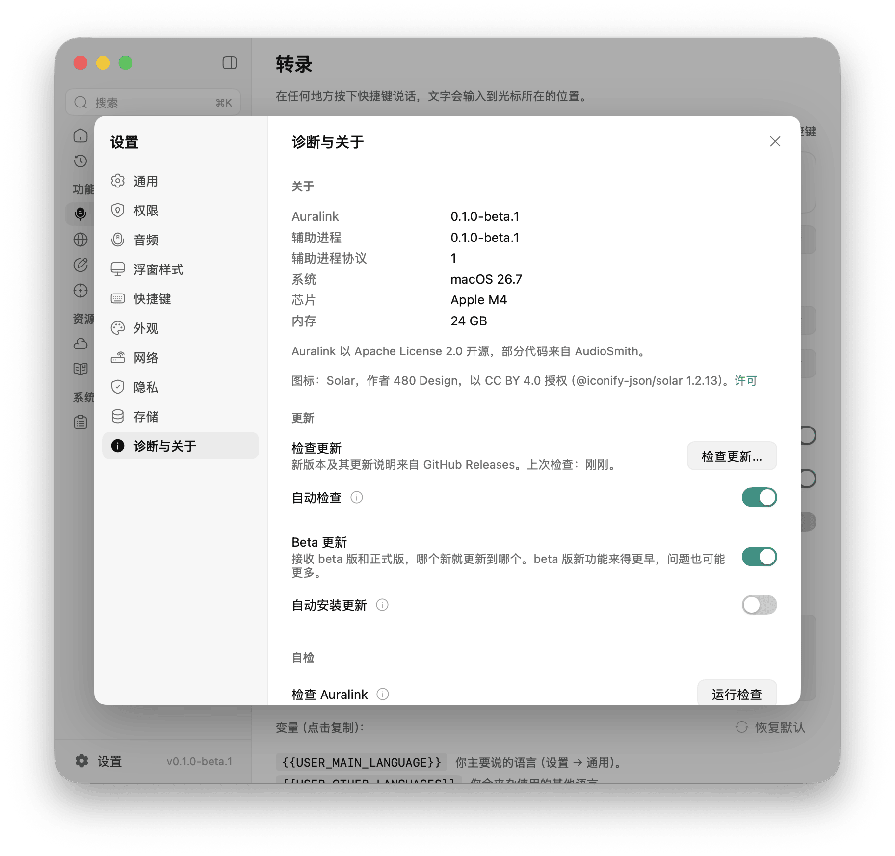

## 支持的服务

至少需要一个语音识别服务。整理、翻译和转写需要语言模型。

**语音识别**

| 服务 | 方式 | 内置的模型 |
|---|---|---|
| 豆包（火山引擎） | 流式，实时显示文字 | 流式语音识别 2.0、1.0 |
| 阿里云百炼 | 流式，实时显示文字 | Fun-ASR、Paraformer、Qwen3-ASR 实时、Qwen-Audio ASR |
| 阶跃星辰 | 录完后上传 | step-asr、step-asr-1.1 |
| OpenAI 兼容 | 录完后上传 | gpt-4o-mini-transcribe、gpt-4o-transcribe、whisper-1，或任何兼容接口上的任何模型（Groq、硅基流动、自建服务等） |

**语言模型**：DeepSeek、通义千问（阿里云百炼，国内和国际站）、火山方舟（豆包）、月之暗面 Kimi（国内和国际站）、智谱 GLM、MiniMax、阶跃星辰、小米 MiMo、硅基流动（国内和国际站）、OpenAI、Anthropic、Google Gemini、OpenRouter、Groq、xAI、Mistral、Together AI、Fireworks AI、Cerebras、NVIDIA NIM，以及任意 OpenAI 兼容的接口。

每个预设都有默认模型，也可以手动填写其他模型。**模型服务** 页显示每个功能用的是哪个服务（默认用第一个可用的，也可以手动指定），并可以逐个测试连接。API Key 保存在 macOS 钥匙串里，不会出现在设置、历史或日志中。

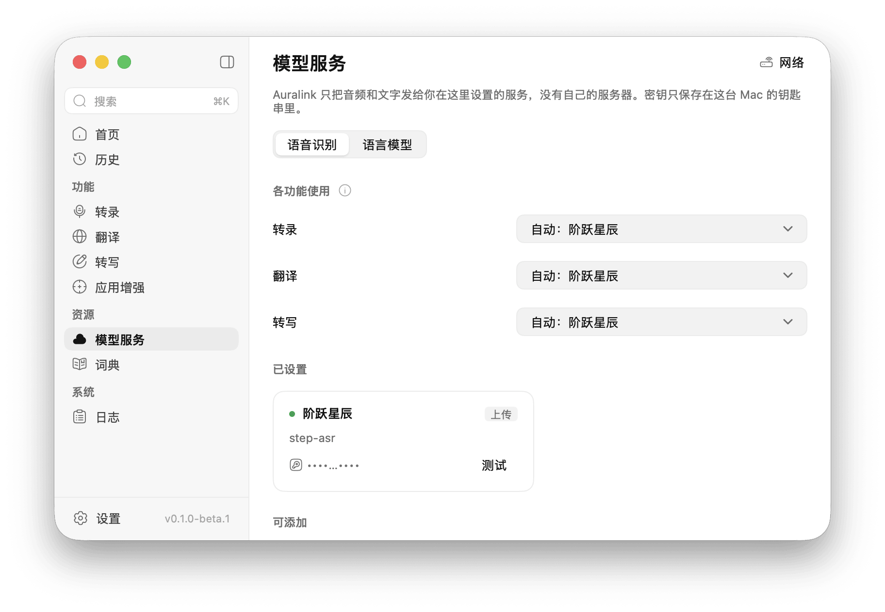

## 隐私

- **不做本地推理，也没有自己的服务器。** 你的音频，以及要整理、翻译、改写的文字，只发给你配置的服务；服务收到的内容适用该服务自己的条款。Auralink 不需要账号，不收集使用数据、崩溃报告或任何标识符。
- **Key** 只保存在这台 Mac 的钥匙串里。
- **历史** 只保存在本机 `~/Library/Application Support/Auralink`（可在 **设置 → 存储** 中移动）。在 **设置 → 隐私** 中可以关闭历史、打开保存录音（默认关闭），也可以清除全部历史。日志里只记长度和耗时，除非你允许，否则不记录文字内容。
- **浏览器网址** 只通过辅助功能读取，用来匹配应用增强分组，不会发给模型；发给模型的只有 App 的名字。
- 除了你配置的服务，Auralink 只会访问 GitHub 检查更新，以及你在设置里主动测试的地址（网络测试、自检）。

## 安装

Auralink 需要 **macOS 15 及以上、Apple 芯片的 Mac**。暂不支持 Intel Mac。

1. 从 [Releases](https://github.com/hehehai/Auralink/releases) 下载 `Auralink <版本> arm64.dmg`，把 Auralink 拖进“应用程序”。发布版本用 Developer ID 签名并经过 Apple 公证，打开时不会有安全警告。
2. 从“应用程序”里打开（直接在磁盘映像里运行无法自动更新）。自动更新要求 Auralink 能写入它所在的位置：放在 `/Applications` 需要管理员账户，否则请放到 `~/Applications`。
3. 设置引导会请求两项权限：
   - **麦克风**：只在快捷键触发录音时使用。
   - **辅助功能**：把结果输入到其他 App、为翻译和转写读取选中的文字、把 `fn` 用作快捷键，以及为应用增强读取前台 App 和浏览器标签页。没有这项权限时，结果会复制到剪贴板，而不是直接输入。

**以前用过自己编译的版本**（ad-hoc 签名）：macOS 不会把它的授权带到发布版。打开发布版之前执行一次 `tccutil reset Microphone dev.hehehai.auralink && tccutil reset Accessibility dev.hehehai.auralink`，再重新允许这两项。

## 快速上手

1. 在设置引导里（或之后在 **模型服务** 页）添加一个语音识别服务和一个语言模型，填好 Key 并测试连接。比如语音识别用阶跃星辰，语言模型用 DeepSeek。
2. 点进任意输入框，轻按 `fn`，说话，再按一次 `fn`。文字出现在光标处。
3. 选中一句话，按 `fn` `⇧` 翻译；或者按 `fn` `⌃`，说出要怎么改。
4. 在 **应用增强** 里为聊天软件或某个网站建一个分组，写上场景 prompt；在 **词典** 里加上总被识别错的人名和术语。

设置引导之后可以从首页的 **设置引导** 或 **设置 → 通用** 重新打开。

## 从源码构建

需要 Go 1.27.1（`GOTOOLCHAIN=auto` 会自动获取）；打包需要 macOS 15 及以上的 Apple 芯片 Mac，以及用来编译 Swift 辅助进程的 Xcode。

```sh
scripts/build-helper.sh              # 编译辅助进程，放到 resources/darwin-arm64/helper/
go tool mygo dev                     # 热重载运行
go tool mygo build                   # 生成 build/darwin-arm64/Auralink.app 和 “Auralink 0.1.0 arm64.dmg”
```

在 Linux 上开发时，`scripts/mac.sh <命令>` 会把项目同步到 Mac（`MAC_HOST` 默认 `mac-air`，`MAC_DIR` 默认 `code/Auralink`）并在那边执行，例如 `scripts/mac.sh 'scripts/build-helper.sh && go tool mygo build'`。

<details>
<summary>开发时的签名（重新编译后保留权限）</summary>

macOS 按签名记住麦克风和辅助功能授权。默认的 ad-hoc 签名每次重编 app 都会变，重编之后授权就失效了：麦克风变成**拒绝，而且不再弹窗**；辅助功能在系统设置里看着还开着，实际不生效。辅助进程的授权算在 app 名下（macOS 按负责进程 Auralink.app 判定），所以它也一样。几个办法：

- **只改辅助进程时**：保留一个编好的 app，让它用 bundle 外的辅助进程。辅助进程放在哪里都继承 app 的授权，重编它不影响授权：
  ```sh
  scripts/build-helper.sh --out ~/auralink-dev
  open --env AURALINK_HELPER=$HOME/auralink-dev/auralink-helper build/darwin-arm64/Auralink.app
  ```
- **清掉重来**：`tccutil reset Microphone dev.hehehai.auralink`（`Accessibility` 同理），再打开 app 重新授权。如果辅助功能条目开着却不生效，在系统设置里用 − 删掉它再重新授权。
- **用固定的签名身份**：用 Apple Development 证书签名，重编后授权仍然有效：`go tool mygo build -sign "Apple Development: …"`（或者在本地的 mygo.json 里设 `macos.signingIdentity`；`scripts/build-helper.sh` 用 `AURALINK_SIGN_IDENTITY`）。通过 ssh 签名时 `codesign` 会报 `errSecInternalComponent`，需要先在 Mac 的终端里执行一次 `security set-key-partition-list -S apple-tool:,apple: -s ~/Library/Keychains/login.keychain-db`。

</details>

## 开发

Auralink 是基于 [MyGo](https://github.com/egoist/mygo) 的 Go app（用 Go 写原生 macOS 界面，不用 cgo），另有一个小的 Swift 辅助进程，负责需要 Apple 框架的部分：麦克风、全局快捷键、辅助功能、粘贴和 App 图标。决策都在 Go 这边，辅助进程通过 stdin/stdout 上的 JSON 行接收指令并执行。除辅助进程外都是纯 Go 代码，在 Linux 上测试。

```sh
CGO_ENABLED=0 go test ./...          # 全部测试，Linux 上可跑
go tool mygo vet .                   # go vet 加 MyGo 的 UI 生命周期检查
AURALINK_SNAPSHOTS=/tmp/shots go test -run TestSnapshots .   # 每个页面的截图：浅色/深色 × 中/英
cd helper && swift test              # Swift 辅助进程的测试（在 Mac 上），和 Go 用同一份协议 fixtures
```

存储层的测试用 MyGo 的 SQLite 插件，第一次会下载它的库（校验 SHA-256），也可以用 `MYGO_SQLITE_LIBRARY` 指定。在 Linux 上，浮窗中文文字的像素检查需要 CJK 字体（Ubuntu 装 `fonts-noto-cjk`）。本 README 的截图和录屏来自 Mac 上的演示构建：[scripts/readme-media](scripts/readme-media/README.md)。

CI 在 Linux 上跑 gofmt、Go 测试（含 race 检测）和 MyGo vet，在 macOS 上跑辅助进程的测试。需要权限、屏幕和真实服务的部分，按 [docs/manual-test.md](docs/manual-test.md) 手动验证。发布版本由 GitHub Actions 在打 tag 时构建、签名、公证并上传，见 [docs/release.md](docs/release.md)。

- [docs/architecture.md](docs/architecture.md)：包结构、线程规则、会话、prompt 组装、磁盘上的数据。
- [docs/behavior.md](docs/behavior.md)：和 Voxt 行为上的差异及原因。
- [docs/helper-protocol.md](docs/helper-protocol.md)：辅助进程的协议。
- [AGENTS.md](AGENTS.md)：修改代码要遵守的规则（界面文字、线程、辅助进程协议）。
- [CHANGELOG.md](CHANGELOG.md)：各版本的更新记录。
- [CONTRIBUTING.md](CONTRIBUTING.md)：怎么提交改动，以及 CLA。

## 致谢

- [Voxt](https://github.com/hehehai/voxt)：Auralink 按功能逐项重写了它的行为，只用远程模型。浮窗的图标、菜单栏的麦克风图标和浮窗预览的背景图来自 Voxt。
- [AudioSmith](https://github.com/hehehai/AudioSmith)：窗口外壳、UI 组件、设置、存储，以及辅助进程监管程序的原型都来自它。
- [MyGo](https://github.com/egoist/mygo)：用 Go 写原生 macOS 界面，不用 cgo（MIT 许可）。
- 480 Design 的 [Solar](https://www.figma.com/community/file/1166831539721848736) 图标，以 CC BY 4.0 授权。

## 参与贡献

欢迎提 issue 和 PR：做法见 [CONTRIBUTING.md](CONTRIBUTING.md)，其中也说明了怎么签[贡献者许可协议](CLA.md)（在第一个 PR 里评论一句即可）。

## 许可证

Copyright (C) 2026 actnow and the Auralink contributors。Auralink 是自由软件，以 [GNU Affero 通用公共许可证第 3 版或更高版本](LICENSE)（AGPL-3.0-or-later）发布。

简单说：你可以使用、研究、修改和分享 Auralink。发布它（无论改没改）时，要把同样的自由传下去：附上源码，并使用同一许可。AGPL 在 GPL 之外只多一条：如果你修改了 Auralink，并让别人通过网络使用你的修改版，也要向他们提供源码。Auralink 是桌面应用，在自己的 Mac 上照常使用，没有任何额外要求。

贡献按 [CLA](CLA.md) 接收：贡献者保留版权，并授权 actnow 也可以用其他协议发布其贡献。v0.1.0-beta.1 及以前的版本以 Apache License 2.0 发布。第三方素材及其许可见 [NOTICE](NOTICE)。
